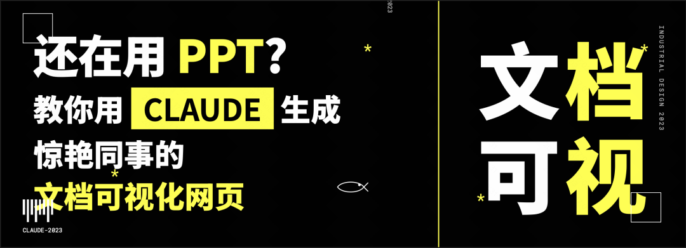
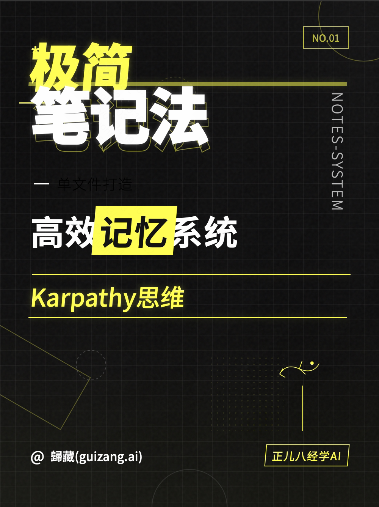

# 小红书 / 公众号封面提示词资产库

从 [一套提示词帮你实现小红书、公众号封面，附10套风格提示词！](https://aibook.ren/archives/ai-use-prompt-for-xiaohongshu) 抽出的可复用提示词资产，**每套提示词都与它的示例封面图一一对应**。

- 原文作者：歸藏（[原文链接](https://mp.weixin.qq.com/s/OFCgFrXNQgIT2ho3V-4Oag)），授权 CC BY 4.0
- 资产整理：本仓库，图片与提示词保持原始对应关系，未做改写
- 机器可读索引：`manifest.json`

## 目录结构

```
xhs-cover-prompts/
├── base/                        # 平台级提示词（与风格无关）
│   ├── xiaohongshu-cover.md     # 小红书封面 3:4
│   ├── wechat-cover.md          # 公众号封面 3.35:1（含 2.35:1 + 1:1 双封面）
│   └── style-extractor.md       # 从参考图提炼新风格的元提示词
├── styles/                      # 10 套风格，每套一个目录
│   └── NN-slug/
│       ├── prompt.md            # 风格提示词全文
│       └── preview-N.png        # 该风格对应的示例封面（原图）
└── examples/
    ├── xhs-cover-example.png    # 小红书封面成品示例
    ├── wechat-cover-example.png # 公众号双封面成品示例
    └── prompt-anatomy.png       # 提示词四段结构图解
```

## 提示词的四段结构

整套提示词是模块化的，四段拼起来才是一份完整可用的提示词：

| 段落 | 作用 | 来源 |
| --- | --- | --- |
| 角色设定 | 设定 AI 身份与主任务（资深网页/营销视觉设计师） | `base/*.md` 开头 |
| 基本要求 | 约束画幅比例、排版共性、技术实现（Tailwind / html2canvas / 下载按钮） | `base/*.md` |
| 风格要求 | 视觉风格模块，小红书与公众号共用，可自由替换 | `styles/*/prompt.md` |
| 用户输入内容 | 标题文案、账号名、标语、背景图/emoji 素材链接 | 使用时填写 |

组合顺序：`base/<平台>.md` → 末尾追加 `styles/<风格>/prompt.md` → 填入用户输入内容。

## 基础提示词

| 提示词 | 文件 | 说明 |
| --- | --- | --- |
| 小红书封面生成提示词 | [base/xiaohongshu-cover.md](base/xiaohongshu-cover.md) | 3:4 竖版，文字占 70%，html2canvas 一键保存 |
| 公众号封面提示词 | [base/wechat-cover.md](base/wechat-cover.md) | 3.35:1，一次生成 2.35:1 主封面 + 1:1 分享封面 |
| 风格生成提示词 | [base/style-extractor.md](base/style-extractor.md) | 喂参考图，自动产出「设计/文字排版/视觉元素」三段式风格描述 |

## 十套风格索引（提示词 ↔ 示例图）

| # | 风格 | 提示词 | 示例图 |
| --- | --- | --- | --- |
| 01 | 柔和科技卡片风 | [prompt](styles/01-soft-tech-card/prompt.md) | [1](styles/01-soft-tech-card/preview-1.png) · [2](styles/01-soft-tech-card/preview-2.png) |
| 02 | 现代商务资讯卡片风 | [prompt](styles/02-business-news-card/prompt.md) | [1](styles/02-business-news-card/preview-1.png) · [2](styles/02-business-news-card/preview-2.png) |
| 03 | 流动科技蓝风格 | [prompt](styles/03-flowing-tech-blue/prompt.md) | [1](styles/03-flowing-tech-blue/preview-1.png) · [2](styles/03-flowing-tech-blue/preview-2.png) |
| 04 | 极简格栅主义封面风格 | [prompt](styles/04-minimal-grid/prompt.md) | [1](styles/04-minimal-grid/preview-1.png) · [2](styles/04-minimal-grid/preview-2.png) |
| 05 | 数字极简票券风 | [prompt](styles/05-digital-ticket/prompt.md) | [1](styles/05-digital-ticket/preview-1.png) · [2](styles/05-digital-ticket/preview-2.png) |
| 06 | 新构成主义教学风 | [prompt](styles/06-neo-constructivist/prompt.md) | [1](styles/06-neo-constructivist/preview-1.png) · [2](styles/06-neo-constructivist/preview-2.png) |
| 07 | 奢华自然意境风 | [prompt](styles/07-luxury-nature/prompt.md) | [1](styles/07-luxury-nature/preview-1.png) · [2](styles/07-luxury-nature/preview-2.png) |
| 08 | 新潮工业反叛风 | [prompt](styles/08-industrial-rebel/prompt.md) | [1](styles/08-industrial-rebel/preview-1.png) · [2](styles/08-industrial-rebel/preview-2.png) |
| 09 | 软萌知识卡片风 | [prompt](styles/09-soft-cute-card/prompt.md) | [1](styles/09-soft-cute-card/preview-1.png) · [2](styles/09-soft-cute-card/preview-2.png) |
| 10 | 商务简约信息卡片风 | [prompt](styles/10-business-info-card/prompt.md) | [1](styles/10-business-info-card/preview-1.png) · [2](styles/10-business-info-card/preview-2.png) · [3](styles/10-business-info-card/preview-3.png) |

## 风格速查

| # | 风格 | 一句话适用场景 |
| --- | --- | --- |
| 01 | 柔和科技卡片风 | 产品数据、年度总结、SaaS 功能介绍 |
| 02 | 现代商务资讯卡片风 | 行业资讯、财经/科技新闻解读 |
| 03 | 流动科技蓝风格 | AI 工具、技术科普、开发者内容 |
| 04 | 极简格栅主义封面风 | 观点输出、设计感强的个人 IP |
| 05 | 数字极简票券风 | 活动预告、清单体、方法论拆解 |
| 06 | 新构成主义教学风 | 教程、知识体系、设计理论 |
| 07 | 奢华自然意境风 | 生活方式、旅行、品牌调性内容 |
| 08 | 新潮工业反叛风 | 职场吐槽、犀利观点、年轻向内容 |
| 09 | 软萌知识卡片风 | 泛知识、生活技巧、亲和力人设 |
| 10 | 商务简约信息卡片风 | 干货清单、职场效率、产品测评 |

## 示例

**风格 08 · 新潮工业反叛风**




## 如何新增风格

1. 用 `base/style-extractor.md` 里的提示词 + 你喜欢的 1-5 张参考图，让模型输出三段式风格描述。
2. 在 `styles/` 下新建 `NN-english-slug/`，写入 `prompt.md`，把参考图存为 `preview-N.png`。
3. 在 `manifest.json` 和本文件的索引表里各加一行。

## 使用

- 直接用：把 `base/<平台>.md` + `styles/<风格>/prompt.md` 拼成一条提示词，填好「用户输入内容」发给支持 HTML/CSS 输出的模型（Claude、DeepSeek V3 0324 等），运行生成的 HTML 即可下载封面。
- 走技能：本仓库 `skills/xhs-cover-designer` 已把这套资产封装成技能，支持自动拼装提示词、按风格选型。
